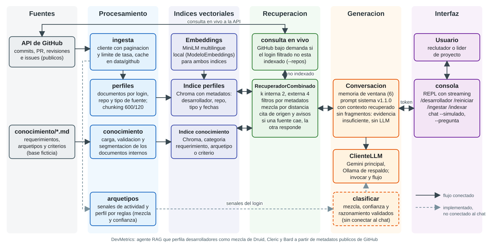
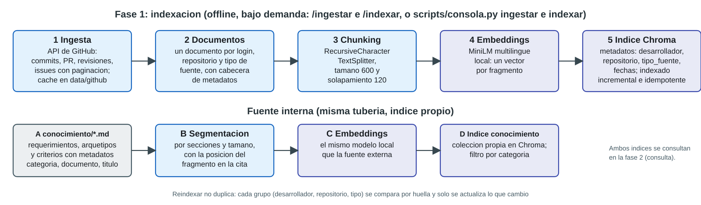
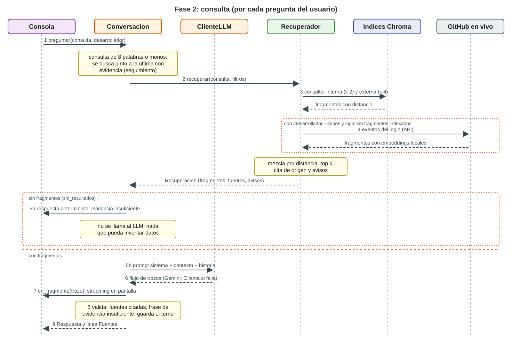

# Arquitectura y diagramas (issue 15, IE4 e IE7)

Estado de lo descrito: refleja `main` en el commit `e65ba27` (incluye la consola con streaming, PR #36 ya fusionado). Los diagramas son archivos SVG en `documentacion/diagramas/`, con proporcion de diapositiva (1600 px de ancho), y se pueden insertar tal cual en la presentacion. Las lineas discontinuas marcan lo que esta implementado pero todavia no conectado al chat.

## 1. Diagrama de arquitectura



Archivo: [diagramas/arquitectura.svg](diagramas/arquitectura.svg). Se lee de izquierda a derecha: las fuentes se procesan sin conexion (columnas 1 a 3), y en cada pregunta el flujo va de la consola a la conversacion, al recuperador y al LLM (columnas 4 a 6).

### Componentes e integracion

| Capa | Componente | Ruta | Responsabilidad | Integra con |
| --- | --- | --- | --- | --- |
| Procesamiento | ingesta | `src/devmetrics/ingesta/` | Descarga commits, PR, revisiones e issues de repositorios publicos con paginacion, limite de tasa y cache en `data/github/`; esquema propio | API de GitHub; alimenta perfiles y arquetipos |
| Procesamiento | perfiles | `src/devmetrics/perfiles/` | Un documento por login, repositorio y tipo de fuente; chunking 600/120 | Indice de perfiles |
| Procesamiento | conocimiento | `src/devmetrics/conocimiento/` | Carga y segmenta `conocimiento/*.md` (requerimientos, arquetipos, criterios) | Indice de conocimiento |
| Procesamiento | arquetipos | `src/devmetrics/arquetipos/` | Senales de actividad y perfil por reglas (mezcla, dominante, confianza); configuracion en JSON | Recibe la `Actividad` que arma `ingesta.actividad_de`; alimenta a `clasificar` |
| Indices | embeddings | `src/devmetrics/llm/embeddings.py` | `ModeloEmbeddings`, MiniLM multilingue local | Ambos indices y la consulta en vivo |
| Indices | IndiceVectorial | `src/devmetrics/indexacion/` | Chroma con metadatos, indexado incremental idempotente, filtros | Recuperador |
| Recuperacion | RecuperadorCombinado | `src/devmetrics/recuperacion/recuperador.py` | Consulta ambos indices, mezcla por distancia, cita el origen y reporta avisos; cada fuente es independiente | Conversacion |
| Recuperacion | consulta en vivo | `src/devmetrics/recuperacion/en_vivo.py` | `crear_en_vivo`: si el login filtrado con `/desarrollador` no esta indexado, trae su actividad de GitHub y la convierte en fragmentos | Recuperador, ingesta |
| Generacion | Conversacion | `src/devmetrics/agente/cadena.py` | Cadena RAG con memoria de ventana, prompt `sistema`, evidencia insuficiente sin llamar al LLM | Recuperador, ClienteLLM, consola |
| Generacion | ClienteLLM | `src/devmetrics/llm/cliente.py` | Gemini principal y Ollama de respaldo; `invocar` (con reintentos) y `flujo` (streaming) | Conversacion, clasificar |
| Generacion | clasificar | `src/devmetrics/agente/clasificacion.py` | Clasificacion con razonamiento y salida validada, contrastada con el perfil por reglas | ClienteLLM, arquetipos; no conectado al chat |
| Generacion | prompts | `prompts/*.toml`, `src/devmetrics/prompts/` | Biblioteca versionada (sistema, clasificacion, recomendacion, tipo de cambio) | Conversacion y clasificar |
| Interfaz | consola | `src/devmetrics/consola.py`, `scripts/consola.py` | REPL con streaming y comandos `/ingestar`, `/indexar`, `/desarrollador`, `/reiniciar` | Conversacion, ingesta, indexado |

### Decisiones de arquitectura

- **Dos fuentes en dos indices, un recuperador.** La fuente interna (criterios de la organizacion) y la externa (actividad de GitHub) tienen filtros distintos: por categoria la primera, por desarrollador, repositorio, tipo y fechas la segunda. Un recuperador las consulta por separado y mezcla por distancia; si una cae, la otra responde y el fallo queda en `avisos`.
- **GitHub en vivo solo como respaldo.** El indice es la ruta normal; la consulta en vivo se activa cuando hay un filtro de desarrollador activo (`/desarrollador`), ese login no tiene fragmentos indexados y el chat se inicio con `--repos`; sin el filtro no se activa.
- **Evidencia insuficiente determinista.** Sin fragmentos no se llama al LLM, de modo que no hay nada que inventar (RF12).
- **Proveedor de LLM intercambiable.** Gemini y Ollama se eligen por variables de entorno y el respaldo conmuta ante fallas; en streaming conmuta solo si el proveedor falla antes del primer trozo.
- **Embeddings locales.** Sin costo ni dependencia de red tras la primera descarga del modelo.
- **Perfil por reglas y perfil por LLM separados.** `arquetipos` calcula la mezcla de forma determinista y `clasificar` la contrasta con el razonamiento del LLM y registra discrepancias.

## 2. Diagrama de flujo RAG

El flujo tiene dos fases: indexacion (offline) y consulta (por pregunta).

### Fase 1: indexacion



Archivo: [diagramas/flujo_indexacion.svg](diagramas/flujo_indexacion.svg). Comandos: `python scripts/consola.py ingestar ...`, `indexar perfiles` e `indexar conocimiento` (o `/ingestar` e `/indexar` dentro del chat) (ver el README).

### Fase 2: consulta



Archivo: [diagramas/flujo_consulta.svg](diagramas/flujo_consulta.svg). Notas sobre el diagrama:

- El texto se muestra a medida que llega (paso 7) y se valida despues (paso 8): una cita inventada por el modelo aparece en pantalla, pero la linea `Fuentes:` solo lista fuentes que fueron recuperadas y que el texto cita literalmente.
- Un fallo del LLM propaga el error y el turno no se guarda en la memoria.
- Un seguimiento de 8 palabras o menos se busca junto a la ultima pregunta que si tuvo evidencia; es una heuristica sin calibrar (ver `documentacion/pruebas.md`, issue 12).

## 3. Bocetos de dialogo

Son bocetos de diseno para la presentacion: ilustran el comportamiento esperado y el formato de las citas, **no son salidas reales** del sistema. Los logins son alias neutros y las cifras son de ejemplo (RNF6). El comportamiento de cada boceto se respalda en la columna "Respaldo".

| Boceto | Respaldo |
| --- | --- |
| 1. Perfil de un desarrollador | Regla del prompt `sistema` (mezcla, confianza y fuentes); formato de cita de `fragmentos.citar` |
| 2. Pregunta de seguimiento | `Conversacion` con memoria de ventana y busqueda ampliada |
| 3. Poca actividad | Regla del prompt `sistema` y guardia de `clasificar` (confianza baja o datos insuficientes) |
| 4. Evidencia insuficiente | Respuesta determinista de `Conversacion` (sin LLM) |
| 5. Asignacion a un requerimiento | Diseno objetivo (RF16, comparar y ordenar candidatos); aun no implementado |

### Boceto 1: perfil de un desarrollador

```
> Que perfil tiene dev_a?
Perfil de dev_a: mezcla Druid 0.55, Cleric 0.30, Bard 0.15; clase dominante
Druid con confianza media. Predominan cambios en migraciones y configuracion
de base de datos (commits de marzo y abril) y revisa PR de otros de forma
ocasional.
Fuentes: GitHub: org/repo / commits / @dev_a, 2026-03-02 a 2026-04-20,
fragmento 1/3; conocimiento interno: Definicion del arquetipo Druid (arquetipo_druid.md)
```

### Boceto 2: pregunta de seguimiento

```
> Y en documentacion?
Con la ventana de la conversacion se busca "Que perfil tiene dev_a? Y en
documentacion?". dev_a aporta poca documentacion: dos cambios en README, lo
que explica la proporcion baja de Bard.
Fuentes: GitHub: org/repo / commits / @dev_a, 2026-04-21 a 2026-05-02
```

### Boceto 3: poca actividad

```
> Que perfil tiene dev_b?
dev_b tiene actividad publica muy limitada (pocos eventos). No se declara una
clase dominante: confianza baja. Tendencia observada hacia Cleric por sus
correcciones. Con mas revisiones o cambios en distintas areas el perfil
seria mas firme.
Fuentes: GitHub: org/repo / commits / @dev_b, 2026-05-10 a 2026-05-12
```

### Boceto 4: evidencia insuficiente

```
> Que perfil tiene dev_z?
Evidencia insuficiente: no hay fragmentos que respalden la consulta. Falta
información sobre el desarrollador, repositorio o criterio consultado;
indica un login o un requerimiento concreto.
```

El mismo formato se usa cuando una fuente cae: los avisos de fuentes no disponibles reemplazan al motivo generico.

### Boceto 5: asignacion a un requerimiento (diseno objetivo)

```
> Quien encaja mejor con la migracion de la plataforma de datos a la nube?
Para req_migracion_nube se ordena a los candidatos por ajuste:
1. dev_a (Druid dominante, confianza media): migraciones y configuracion.
2. dev_c (mixto Druid/Cleric, confianza baja): cambios de infraestructura
   recientes pero poco volumen.
Fuentes: conocimiento interno: Migracion de la plataforma de datos a la nube
(req_migracion_nube.md); GitHub: org/repo / commits / @dev_a, 2026-03-02 a
2026-04-20
```

## 4. Estado de integracion y limites

- `clasificar` y el prompt `recomendacion` existen y se probaron, pero el chat no los invoca: la consola responde con el prompt `sistema`. Conectarlos o no es una decision pendiente (ordenar candidatos, RF16).
- El diagrama describe lo que hay en el repositorio; las cifras de calidad (exactitud, trazabilidad, tiempos) se miden en los issues 16 a 18 y no se afirman aqui.
- Los diagramas son SVG escritos a mano: se editan como texto y no dependen de una herramienta de dibujo. No se genero PNG.
- Los bocetos no estan validados con LLM real.

## 5. Trazabilidad con la pauta y apoyo para la defensa (IE7)

- IE4 (diagrama de arquitectura con componentes clave e integracion): seccion 1.
- IE3 (flujo de informacion del pipeline RAG): seccion 2.
- IE7 (defensa): preguntas que el diagrama debe poder responder.
  - Por que dos indices y no uno: filtros distintos por fuente y fallos independientes.
  - Que pasa si GitHub o el LLM fallan: aviso en la respuesta, respaldo Ollama, sin bucles de reintentos.
  - Como se evita inventar: evidencia insuficiente sin LLM, prompt con restricciones y linea `Fuentes:` restringida a lo recuperado.
  - Que falta conectar: `clasificar` al chat y la comparacion de candidatos.
